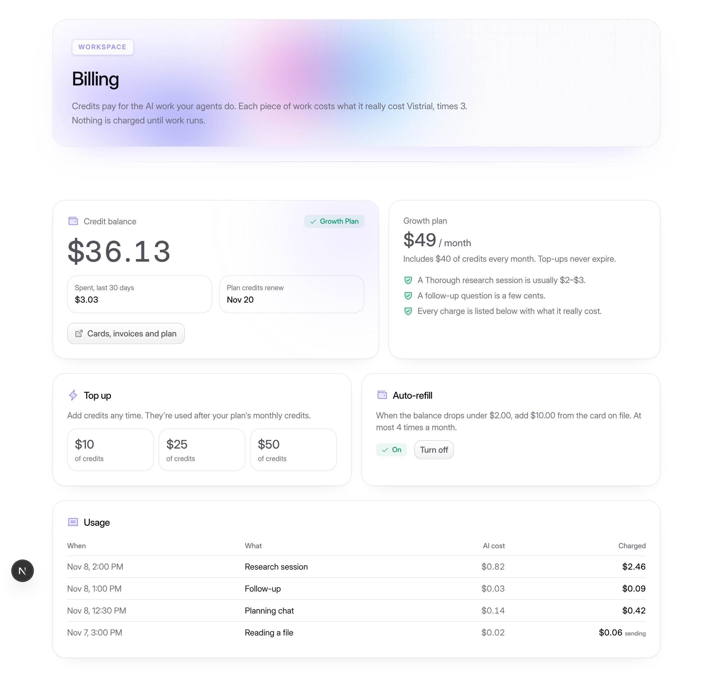

# Billing: credits through Autumn and Stripe

These are the owner's choices:

- **Platform:** Autumn on top of Stripe. Autumn holds plans, balances, top-ups and auto-refill. Stripe takes the payments.
- **Plan:** a monthly plan plus top-ups. **Growth** is $49 a month and includes $40 of credits, which renew monthly.
- **Pricing:** credits are shown in dollars. Each piece of AI work costs what it really cost Vistrial, times 3 (`BILLING_MARKUP`).
- **Top-ups:** $10, $25 or $50 packs, which don't expire.
- **Auto-refill:** opt-in. It adds $10 when the balance drops under $2, at most 4 times a month.
- **At zero:** new work is blocked. Work already running finishes and is charged in full, so the balance can go slightly negative.

## How it works

1. **Charging.** Every spend point calls `chargeUsage`: research runs (`runs.ts`), follow-ups (`followups.ts`), the planning chat (`intake.ts`) and reading files (`files.ts`). It does three things:
   - writes a row to `billingLedger` with the real cost, the markup and the price;
   - lowers the mirrored balance in `billingAccounts` straight away;
   - schedules `billingActions.push`.
2. **Sending to Autumn.** `push` sends the usage to Autumn with `track` (feature `credits`, `overageBehavior: "overflow"`). It then reads the customer back and refreshes the mirror. Charges Autumn did not accept are retried hourly by the "retry billing sync" cron.
3. **The zero-balance check.** `assertCanSpend` runs in `runs.start`, `intake.create`, `intake.reply`, `followups.ask`, `followups.run` and `files.attach`. It blocks only when billing is on (`AUTUMN_SECRET_KEY` is set) and the balance is zero or below. Local and test deployments are never blocked.
4. **The customer.** The Autumn customer ID is the workspace ID, so credits belong to the workspace. Only the Owner can subscribe, buy packs, change auto-refill or open the Stripe portal. Everyone in the workspace sees the balance, and Reps don't see the ledger.
5. **Screens.**
   - Workspace → **Billing** (`/app/billing`) shows the balance, the plan, the top-up packs, auto-refill, the Stripe portal link, and usage with each charge's real AI cost.
   - Every page shows an "Out of credits" notice when the balance is empty.

The Autumn SDK is too large for Convex's default runtime, so every call to Autumn lives in `convex/billingActions.ts`, which runs in Node (`"use node"`).

## Setting it up (one time, in Autumn)

Two internal actions do most of this for you. Run them from the Convex dashboard or the CLI once the key is set:

- `billingActions:checkSetup` reports whether the key works and whether it is a test or live key, and lists any missing feature or plan. It returns IDs only, never the key.
- `billingActions:setupProducts` creates the `credits` feature and the `growth` and `topup` plans. It skips anything that already exists, so running it twice is safe.

The manual steps below are the same setup, done by hand.

1. Create an Autumn account and connect your Stripe account (test mode first).
2. Create a **feature** with ID `credits`, of type metered and single-use. 1 unit = 1 cent of credit.
3. Create a **plan** with ID `growth`:
   - $49 a month;
   - includes 4,000 `credits`, reset monthly.
4. Create a **plan** with ID `topup`:
   - an add-on, one-off;
   - prepaid `credits`, priced at $1 per 100 credits (billing units of 100);
   - the app sends the quantity (1,000, 2,500 or 5,000).
5. Copy the Autumn secret key (`am_sk_...`). Add it as `AUTUMN_SECRET_KEY` in the **Convex** environment variables: dev first, then production when you're ready to charge. Never put it in Vercel, the repo or chat.
6. Optional settings:
   - `BILLING_MARKUP` (default `3`);
   - `AUTUMN_PLAN_ID`, `AUTUMN_TOPUP_ID` and `AUTUMN_FEATURE_ID`, if you name the plans or the feature differently.

**Test or live.** Each deployment picks its key by `AUTUMN_MODE`. With `AUTUMN_MODE=test` (set on dev), it uses `AUTUMN_TEST_SECRET_KEY`: Stripe test mode, so nothing real is charged, and the Billing page says so. Without it (production), it uses the live `AUTUMN_SECRET_KEY`. The products must exist in each Autumn environment, so run `setupProducts` once per mode.

Until the key for the deployment's mode is set, the Billing page says billing isn't switched on and nothing is ever blocked.

## Tests

`convex/billing.test.ts` covers:
- the 3× price;
- that nothing is blocked while billing is off;
- blocking at zero and allowing work with credit;
- charging work already running past zero;
- ledger isolation per workspace, and Reps not seeing the ledger.

Story page: `/dev/billing?state=active|low|empty|off`.

