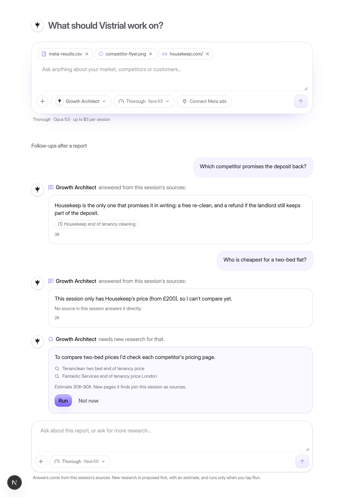
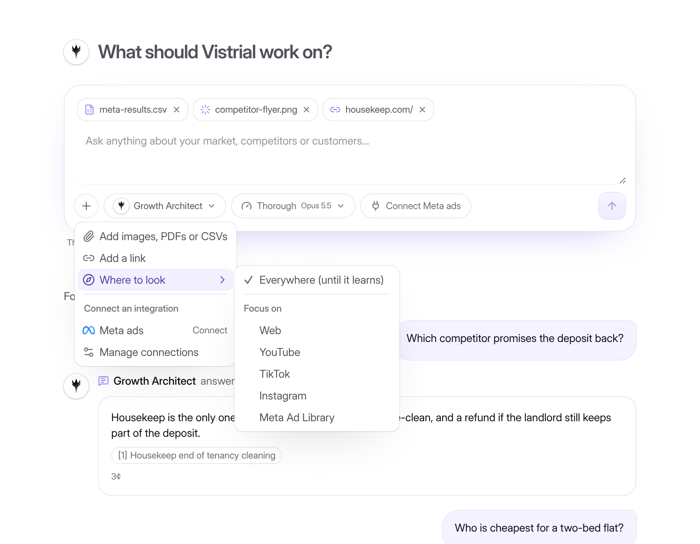

# The chat box

One chat box is used everywhere: on the home page, at the top of each agent, in the header and mobile ask panel, in the intake conversation and inside a finished session. It works like the boxes in Claude and ChatGPT.

## What the box offers

| Control | What it does |
| --- | --- |
| **Agent chip** | Picks the agent. It defaults to the agent of the page you're on. Planned agents show "Coming soon". Once a conversation has started, the agent is locked. |
| **Quality chip** | **Thorough** (Opus 5.5, research capped at $3) is the default. **Fast** (Sonnet 5.5, capped at $1.50) is quicker and costs about half. The mode is stored on the run: Fast sends research and writing to the classify route and lowers the run cap. |
| **+ menu** | Add images, PDFs or CSVs (up to 10 files, 10 MB each). Add a link. **Where to look**: everywhere until Vistrial learns where the audience is, or focus on chosen sources. **Connect an integration**: Meta ads, then Manage connections. |
| **Connect Meta ads** | A shortcut shown only while Meta isn't connected. Connecting happens through the workspace Connections flow, and Facebook sends you back to the page you came from. Only owners can connect. |

## Files

Files are read once, by the classify route, and always as untrusted data. A CSV is sent as its first 200 lines of text. An image or PDF is sent as an attachment. The reading cost counts toward the conversation's cost.

When research starts, each file becomes a source in the session:

- a CSV becomes **your data** (`customerData`), which can back first-party claims;
- an image or PDF becomes **your files** (`upload`).

## Follow-ups after the report

Questions asked after the report are answered from the session's own sources, and each answer costs a few cents. An answer can cite only sources that already exist in the session; made-up ids are dropped.

When an answer needs new research, Vistrial proposes it first: why it's needed, the searches it would run, and an estimate (Thorough 30–90¢, Fast 10–40¢). Nothing is searched until someone taps **Run**, and the approval is recorded in the audit log.

Only pages that the web search actually returned are added to the session as sources. Follow-ups are capped at $4 per session.

## Code

- `src/components/chat/chat-composer.tsx` is the box. `use-chat-extras.ts` holds its mode, sources, links and files, and `start-chat.tsx` uses the box to start a conversation.
- `convex/files.ts` handles uploads and reading. `convex/followups.ts` handles follow-up questions and proposed research. Modes are in `convex/lib/capRows.ts` (`MODES`, `runCaps`).
- Tests are in `convex/chat.test.ts`. The story page is `/dev/chat`.
