# Readable output

Date: 2026-11-13. How Vistrial shows what its AI features produce, so a person understands a result in
seconds and reads the detail only when they want it.

The owner's words: "Vistrial displays a lot of information, a lot of copy with some of our AI features but
we need to find a better way to communicate data and copy, aka text that's generated from users' action.
Example: the page breakdown displays loads of copy but no highlights or indicators for simplification when
it comes to understanding all that text."

This document is the pattern. The blocks it describes are built (`src/components/readable/`,
`src/lib/readable/`) and can be clicked at `/dev/readable-output`. Each screen is rebuilt on them in its
own pull request (see "Order of work"); the Pages tab is the first.

## What is wrong today

Measured on the dev stories, at the fixture each story ships with.

| Screen | Height at 1280 | Height at 390 | What a person meets first |
|---|---|---|---|
| Pages (landing page teardown) | 5,123 px, 6.4 screens | 7,619 px, 9 screens | The standing limit, one summary sentence, then eight boxes of prose |
| Offers (offer analysis) | 2,824 px | 5,356 px | The offer card; the analysis starts 1.5 screens down |
| Diagnostics | 2,046 px | 4,540 px | "Your data", then the constraint |
| Briefing | 2,870 px | 3,757 px | Eleven posts of the same weight |
| Tasks | 1,748 px | 1,841 px | Cards whose reason is a paragraph |
| Research | 807 px | 1,838 px | A list of reports; the report itself is a PDF or the asset page |

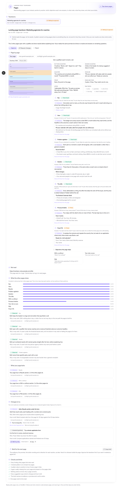
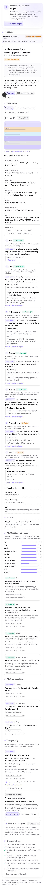
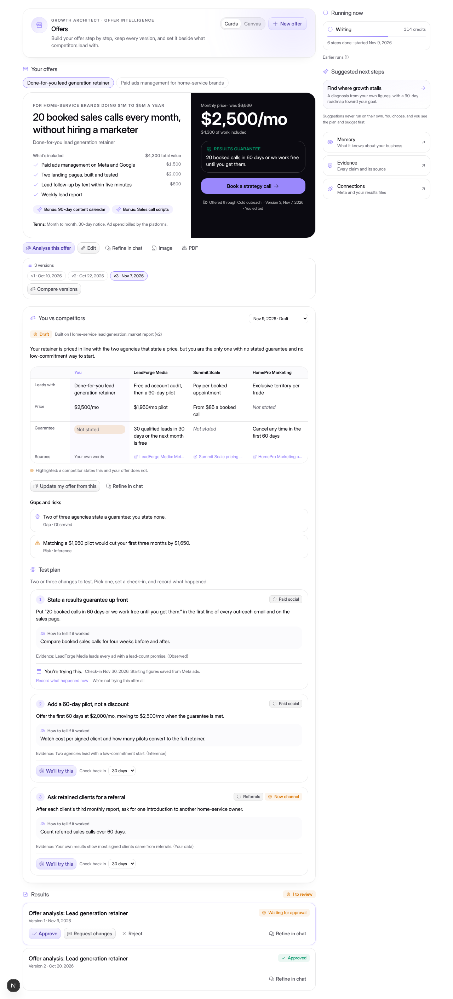
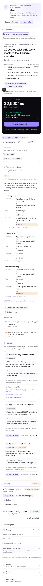

On the Pages tab specifically:

1. **No answer at the top.** The one sentence that says what was found sits between a caveat and the
   approve buttons, in body text. Nothing says how many sections the page has, how many it skips, or what
   to do.
2. **Facts are written as sentences.** "4 buttons: "Book a call", "Apply for a call". They lead to 2 places."
   is three numbers and a problem, set as prose in a box the same weight as seven other boxes.
3. **Every section is open.** Seven sections, each with a status, a framework line, a note and three lines
   of page text, all visible. The status badge is the only indicator, and it is the smallest thing in the row.
4. **What the page skips is at the bottom of the page list,** after everything it has, although the gaps
   are the finding.
5. **The comparison is eleven bars that are nearly all full.** "2 of 2" eleven times does not show the
   three rows where the person's own page differs; that is in a separate list of sentences further down.
6. **Page text is quoted with no marks.** The teardown saved which lines are pains, fixes, proof, the
   qualifier and the price, and draws none of it.
7. **What to do next is 4,000 px down.**

The other screens share numbers 1, 3 and 7 in smaller form. Diagnostics is the closest to right already:
it leads with the constraint and a figure.

## The pattern: three layers, in this order

1. **The answer at a glance.** What was found, in one screen without scrolling: a verdict in a sentence or
   two with its evidence label, a few counts, the few things that matter most, and what to do next.
2. **Scannable structure.** Indicators that let the eye sort the detail before reading it: a status per
   section or finding, counts, labels, short highlights.
3. **The full text.** Everything that is there today, one step away (a disclosure), never deleted.

## Rules every block follows

- **An indicator is computed from the result's own fields and means one stated thing.** Each block below
  names its fields. There is no score, grade or percentage. A count says what was counted.
- **Evidence labels stay on.** Every claim keeps its label (Observed, Inference, Untested hypothesis, Your
  data, Not enough data; words from `convex/lib/evidence.ts`). A summary line carries the **weakest** label
  of what it summarises (`weakestEvidence`, order: Not enough data, Untested hypothesis, Inference, Observed,
  Your data). An unknown label is treated as an inference, never as stronger.
- **Never colour alone.** Every status and label has an icon and words. Each highlight kind has its own
  line style as well as its own colour. Screen readers hear the status or the highlight kind as text.
- **No new unchecked model text.** Where a result has no verdict of its own, code writes a plain one from
  counts. New words from a model (a per-page verdict, a per-section headline) are added as optional fields
  in the skill's output and go through the skill's checks; that is done per screen, not here.
- **Nothing a person can reach today is removed.** Sources, quotes, the screenshot, "We'll try this",
  approve and request changes, and PDF export keep working.
- **No animation is needed.** The disclosure is the browser's own `
`; nothing moves, so reduced
  motion needs no special case.

## The blocks

All in `src/components/readable/`. The numbers match the story.

### 1. Result header and verdict strip (`ResultHeader`, `VerdictStrip`)

The title line (what, when, review status) and then the answer: a sentence or two, its evidence label, up
to four counts, and the standing limit.

Computed from, for a teardown: the saved `summary` (model text the teardown already checks for claims of
a result), the weakest `basisLabel` among its patterns and gaps, and counts of saved rows (pages read,
sections the person's page lacks that another page has, shared patterns, changes to try).

`ResultHeader` holds the **model mark slot** (`ModelMark`). It draws nothing until a result carries a model
name; the model picker and the saved model are another branch's work (`claude/models-openrouter`). Whoever
lands that passes `model` and every result header shows it.

### 2. Coverage map (`CoverageMap`, `CoverageSummary`)

The framework's eleven jobs in the framework's order. Each cell says what this page does about the job and
where the job comes on the page.

| Cell says | Means exactly | Computed from |
|---|---|---|
| Does its job | A section was matched to the job and read as doing it | `sections[].job`, `does = "yes"` |
| Partly | A section was matched and read as doing part of it | `does = "partly"` |
| Does not do its job | A section was matched and read as not doing it | `does = "no"` |
| Skipped | The framework expects the job and no section was matched to it | no section; `framework[].expected = true` |
| Left out (optional) | The framework lets a page leave it out (Results, with no real proof) and this page does | no section; `expected = false` |
| The number | Where the job first appears among the page's sections | order of `sections` |
| Later than the framework | The page puts the job after one the framework places later | page order against framework order |

When two sections do one job, the cell shows the better of the two. The line under the map gives the counts
in words ("7 of 11 jobs have a section: 5 do their job, 2 partly, 0 do not. 3 skipped, 1 left out") and
says that which job a section does is a reading of the page, not a measurement. The page verdict above the
map is that sentence, written in code, labelled Inference; it is the fallback for teardowns saved before
a model-written verdict exists.

### 3. Top three (`TopList`)

Two short lists, "Weakest points" and "What holds up", three shown and the rest behind "N more".

Computed from: sections read as not or partly doing their job (with the section's note as the detail),
jobs with no section (with the objection left unanswered), and what code counted: buttons leading to more
than one place, weak button wording, no proof, pains and fixes that do not pair up, a headline that does
not state an outcome, FAQ topics not covered. Counted facts are labelled Observed; readings are labelled
Inference.

The order is a **fixed rule, not a ranking**: missing or failing first, then partly done, then what code
counted. Vistrial cannot see a page's results, so it cannot rank by importance, and the block says so
under the lists.

### 4. Calls to action at a glance

A count, the distinct button wordings as chips, and one status: "One place to go" or "More than one place
to go". Computed from `facts.ctaCount`, `facts.ctaTexts`, `facts.ctaTargets`, `facts.weakCtas`, all counted
in code from the page. Labelled Observed.

### 5. Sections with status, highlights and collapsed notes (`JobChip`, `MarkedText`, `HighlightLegend`, `Detail`)

One row per section: its number on the page, its name, its status chip, the objection it answers, and only
the page lines that carry a highlight. The note ("why"), the framework's job and every line from the page
are behind one disclosure, closed by default.

Highlights mark the page's own words. The kinds and where each comes from:

| Kind | Line style | Computed from |
|---|---|---|
| Pain | wavy | `pains[]` |
| Fix | solid | `solutions[]` |
| Proof | double | `proof.quotes[]` |
| Qualifier | dashed | `qualifier.quote` |
| Price | dotted | `offer.price` |
| Call to action | solid, whole line | a block the page reader read as a button |

`markText` looks for each saved quote in the line as written (case and spacing aside) and marks it only
where it is found; a quote that is not in the line marks nothing. The teardown already removes quotes that
are not on the page when it saves; this checks again at draw time. The legend lists only the kinds that are
on screen.

### 6. Comparison across pages (`CompareGrid`)

A table: the framework's jobs down, the pages across, the person's page first. A cell says whether the page
has a section doing the job (fully or partly) or none, and nothing more, because that is what the teardown
saved for every page. A section read as not doing its job does not count as having it; the server's table
and its gap check use the same rule. The last columns give
"N of M other pages" and flag the rows where "Yours lacks this". One sentence above it counts those rows.
It replaces the eleven bars and says the same thing they do, plus which page.

### 7. Evidence labels and status chips (`EvidenceLabel`, `EvidenceLegend`, `StatusChip`)

The five labels, each with its own icon, and a legend of what each means for the one-step-away layer.

### 8. Small size (`Digest`)

For a briefing post or a task card: up to three rows, "What changed", "What it means", "What to do", each
from a field the post or task already has, each with its label. A row with nothing to say is left out.
Nothing is written to fill it.

### 9. What to do next (`NextStep`)

The first step the result itself contains (for a teardown, the first change to try), with its evidence
label and a link to it. It repeats a step; it adds none.

## Before and after, the same teardown

Before: `/dev/pages-tab?state=full`. After, as blocks: `/dev/readable-output`.

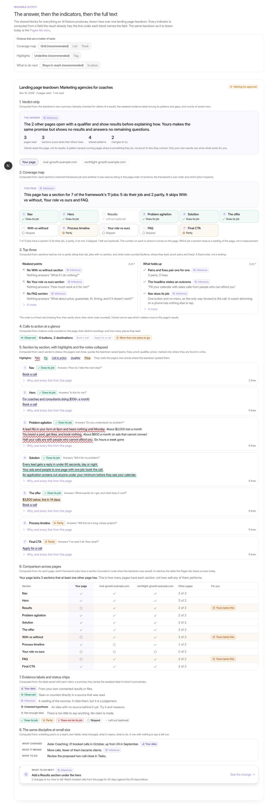
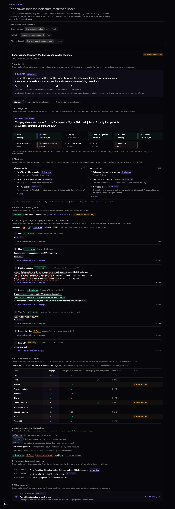
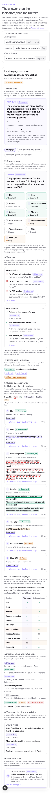
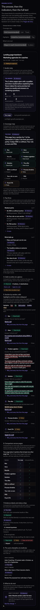

The story is the blocks stacked with a caption each, not the final Pages tab. It has no screenshot of the
page, no review bar and no "We'll try this"; those stay where they are and come with the rebuild.

## Choices that are a matter of taste

Each can be switched in the story.

**Coverage map.** Recommended: **Grid**.

- Grid: eleven cells with the name, the status in words and the page position. Reads without a legend. Two
  rows at desktop, two columns on a phone.
  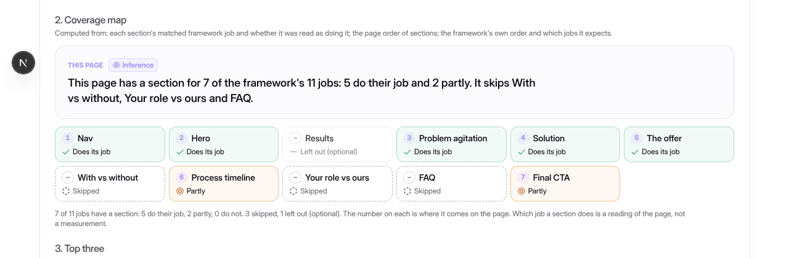
- List: one row per job with the chip at the right. The most readable on a phone, but it is eleven rows
  and looks like the list it replaces.
  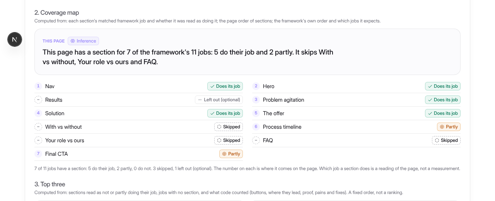
- Track: one row of small cells, icon and name, with a legend. The most compact; it drops the page
  position and leans on the legend.
  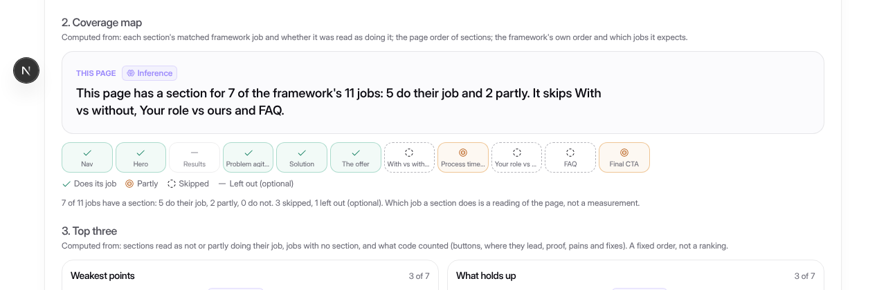

**Highlights.** Recommended: **Underline**.

- Underline: a tinted mark with a line style per kind, explained by the legend. Quiet enough to leave on
  through a long page.
  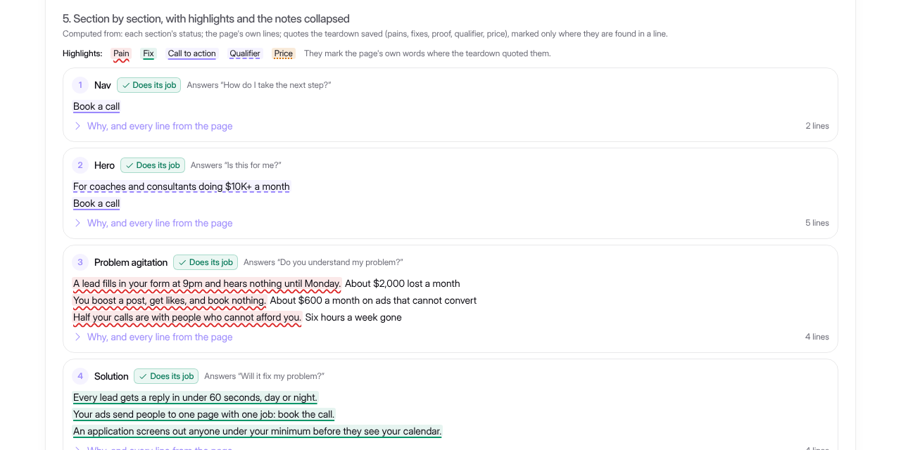
- Tag: a small word before each mark ("PAIN"). Needs no legend, but it puts words into the quoted text
  that the page did not have.
  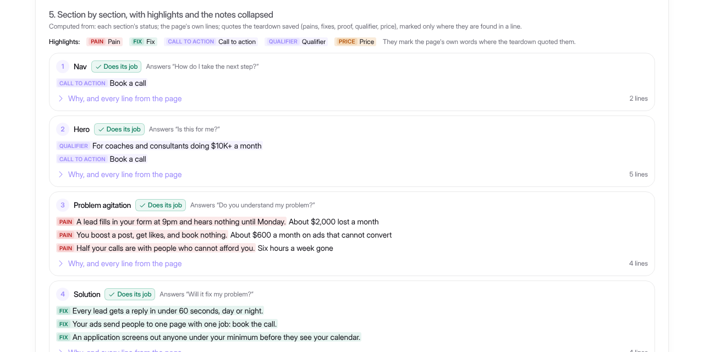

**What to do next.** Recommended: **Stays in reach** (held to the bottom of the screen while the result is
in view). The alternative leaves it in place at the top of the result. The sticky bar costs about 60 px of
a phone screen; if that is too much, use "in place" on phones only.

## What the owner decides

1. Grid, list or track for the coverage map.
2. Underline or tag for highlights.
3. Whether "what to do next" stays in reach or sits in place.
4. Whether the words "Weakest points" and "What holds up" are right. They are plain, and "weakest" is
   about the page's sections against the framework, not about results.
5. Whether the top three should be a fixed order (as built) or left out where there is nothing to rank by.

## Order of work

1. This document, the blocks and the story.
2. Landing page teardown rebuilt on them, with optional model-written fields for a per-page verdict and a
   per-section headline, checked like the rest, and the code fallback for saved teardowns.
3. Research report, offer analysis and growth diagnosis.
4. Briefing posts, the weekly growth report and task cards.
5. The PDF, last, if its layout should follow.

## Landing page teardown, rebuilt (part 2)

The Pages tab is now built from the blocks (`src/components/work/teardown-view.tsx`). Stories:
`/dev/pages-tab?state=full`, and `?state=old` for a teardown saved before pages carried a verdict.

| | Before | After |
|---|---|---|
| First screen at 1280 | The standing limit, one sentence, the approve buttons, a screenshot | The summary with its evidence label, four counts, the approve buttons, and what to do next |
| One page | Eight boxes of prose, then seven open sections | A verdict, the coverage map, three weakest and three strongest points, the buttons, then sections with a status, a headline and only their highlighted lines |
| Across pages | Eleven bars, then two lists of sentences | One table of which page has which section, with "Yours lacks this" on the rows that differ |
| Open by default | Everything | The answer and the indicators. Notes, every page line, the seven other facts, "why it may work", "why, and how to tell" and each check are one step away |

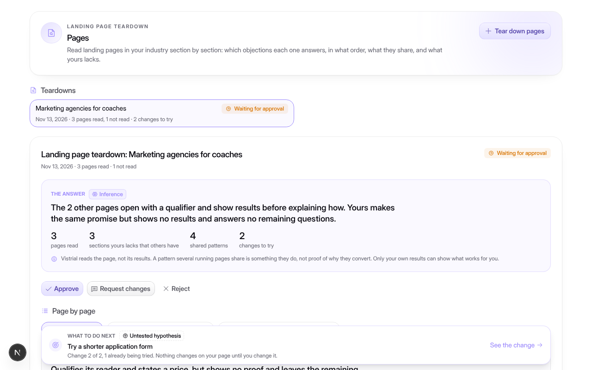
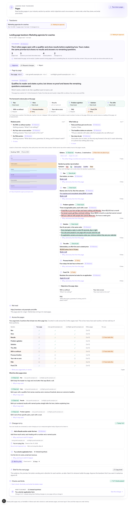
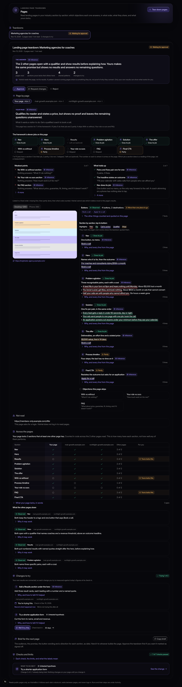
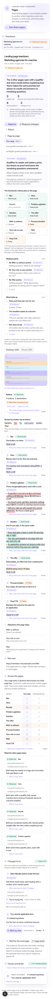
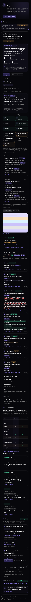
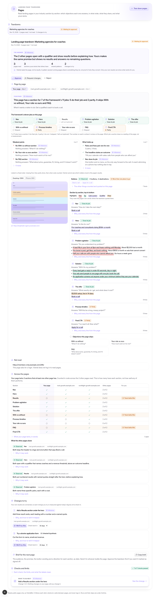

The page is about as long as before (4,824 px against 5,123 at 1280). The aim was the first screen and
what the eye can sort, not a shorter page: with every disclosure closed, a person sees statuses and
highlights, and opens what they want.

Kept, in the same place or one step away: the screenshot at both widths with its link, every quote, the
pages each finding cites, "We'll try this" with its check-in, approve / request changes / reject, the
brief and "Copy brief", "Not read", every check and every limit. The full-page pictures show "what to do
next" at the foot of the result; on a screen it is held to the bottom edge while the result is in view.

New model words: an optional verdict for each page and a headline for each section (see
`landing-page-teardown.md`, "At-a-glance lines"). Everything else in the top layers is computed in code.

## Research report, offer analysis and growth diagnosis (part 3)

No skill, schema or saved shape changed in this part. Each result already has a summary of its own, so the
answer layer uses those words and code adds only counts and labels.

**Research report** (the report page, `/app/assets/[id]`; story `/dev/asset-viewer`). Above the full report:
the report's own first paragraph, the weakest label among its claims, counts (opportunities, claims,
distinct sources cited), how many claims carry each label, each opportunity as a short card (title,
evidence, proposed action; "why" and "how to tell" one step away), an outline that links to each section
with a count of what is in it, and the first proposed action as "what to do next". All of it is read back
out of the report's Markdown and its evidence rows (`reportGlance`); the full report and the claims list
are below, unchanged, and print as before. A claim with no source shows as a red chip in the answer.

A "Not enough data" line makes no claim, so it is counted beside the summary but does not set the
summary's label (`weakestClaim`). When every line is "Not enough data", the summary is too.

**Offer analysis** (Offers tab; story `/dev/offers-tab?state=full`). The analysis's own summary with the
weakest label among its gaps, risks and changes, and counts: competitors compared, how many of the two
compared fields (price, guarantee) a competitor states and the offer does not, gaps, risks, changes to
test. In the table, the amber fill that marked such a field by colour alone is now a chip with an icon and
the words "A competitor states this". Gaps, risks and each change carry an evidence label with its icon;
"how to tell" and the evidence sentence are one step away; the first change nobody is trying is held as
"what to do next".

**Growth diagnosis** (Diagnostics tab; story `/dev/diagnostics-tab?state=full`). "Where growth stalls" now
comes before the data checklist and leads with the stage and its reason, labelled by the rule the skill
saves its evidence with (Your data when figures stand behind the stage, otherwise Not enough data), the
stage's own figures, steps under way, and steps with no figures behind them. Findings, which the tab did
not show before, are one step away with their figures. Each roadmap step carries its label (Inference when
it cites figures, Not enough data when it cites none), and the first step nobody is trying, Fix before
Build before Scale, is "what to do next". The two figures that sat above the roadmap moved into the answer.

| Indicator | Computed from |
|---|---|
| Report summary, objective, opportunities, outline | the report's Markdown body, as written by `renderReport` |
| Claims, sources cited, claims by label, claims with no source | the report's evidence rows |
| Competitors compared; fields a competitor states and you do not | `competitors.length`; `competitors[].gaps.price / .guarantee` |
| Gaps, risks, changes to test | `gapsAndRisks[].kind`, `changes.length` |
| Stall stage label | `hasData`, `stage`, `stageFigures` |
| Roadmap step label; steps without figures | `roadmap[].figures.length` |
| Steps under way; what to do next | "We'll try this" decisions against `roadmap[].index` or `changes[].index` |

Pictures: `report-before-*`, `report-after-*`, `offers-before-*`, `offers-after-*`, `diagnostics-before-*`,
`diagnostics-after-*` in `docs/screenshots/readable-output/`.

Not done in this part: the Research tab's list of reports is unchanged (its rows carry a title and a
status, nothing to summarise without a new query); the PDF is unchanged; the Canvas views of Offers and
Diagnostics are unchanged apart from the shared chips.

## Not done, not tested

- The Pages tab, the report page, the offer analysis and the diagnosis use the blocks. Briefing and Tasks do not yet.
- No real model was run. The new verdict and headline fields were exercised with the scripted model in
  `convex/landingTeardown.test.ts`; what a real model writes in them has not been seen.
- Not tested with a screen reader by a person. The markup is a list, a table with row and column headers,
  native disclosures and text labels; that was checked in code, not by ear.
- Contrast was looked at in light and dark screenshots, not measured with a tool.
- The story draws one made-up teardown. A page whose sections are out of framework order, or with a
  section read as not doing its job, is covered by unit tests but has no picture.
