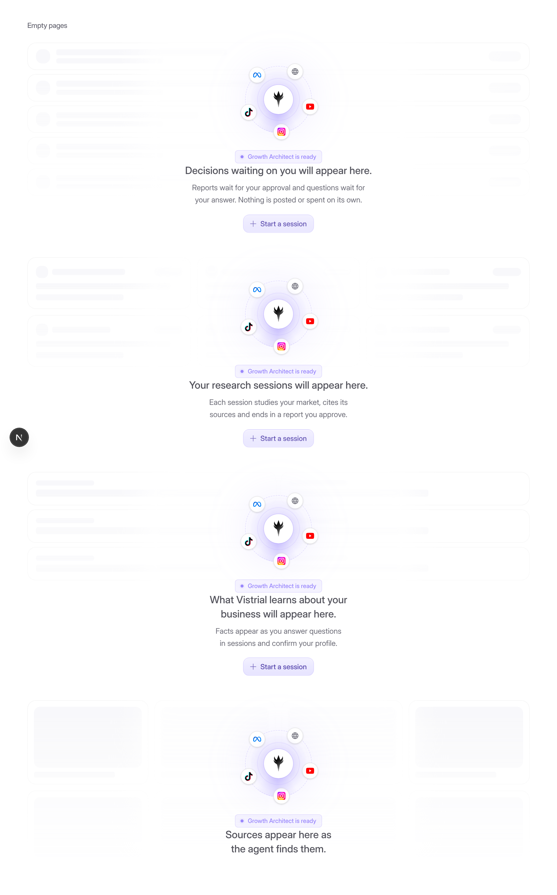
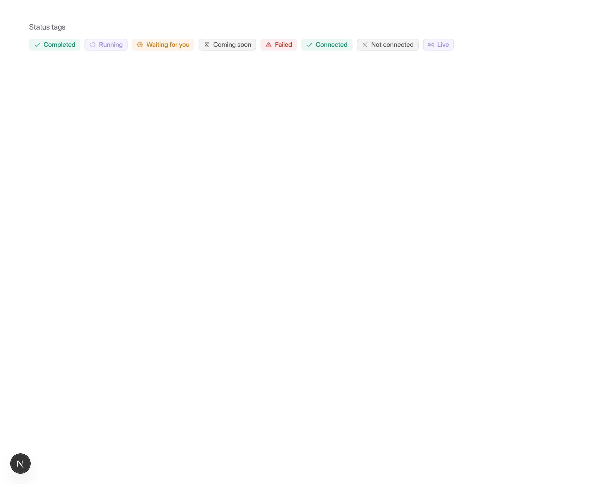
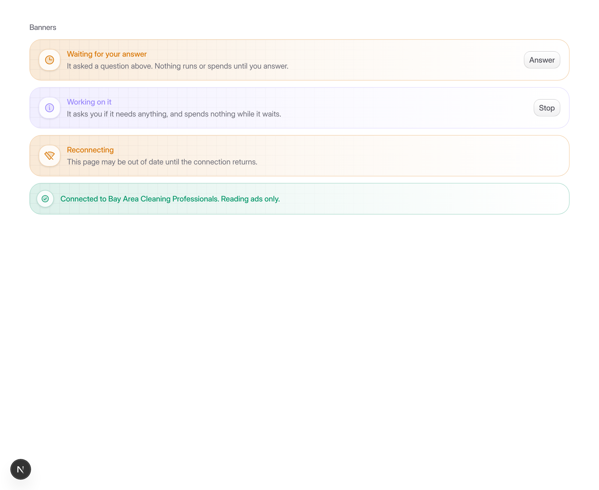
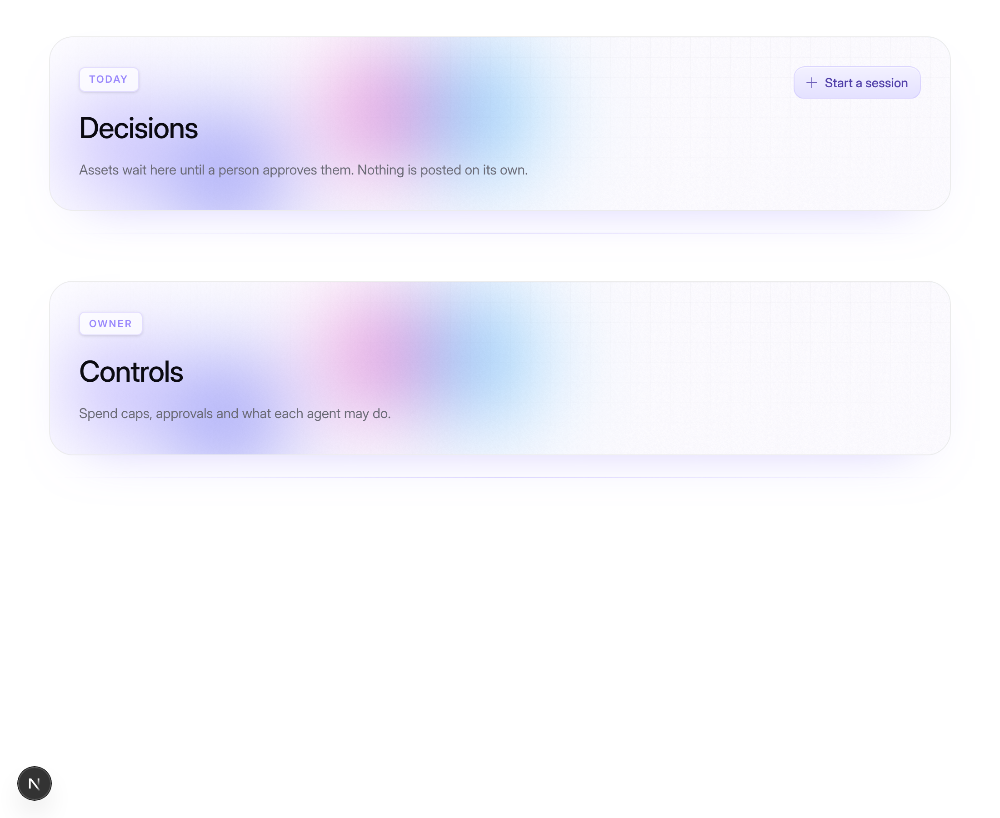
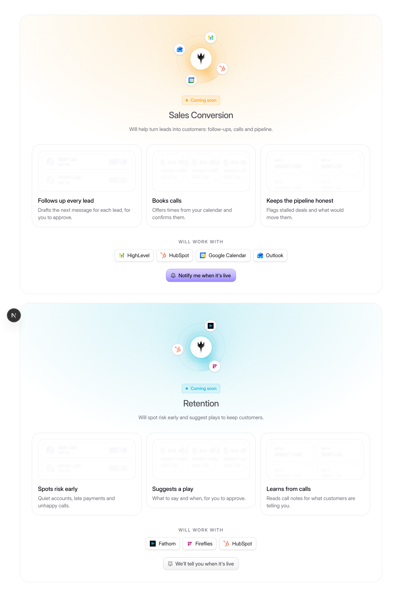
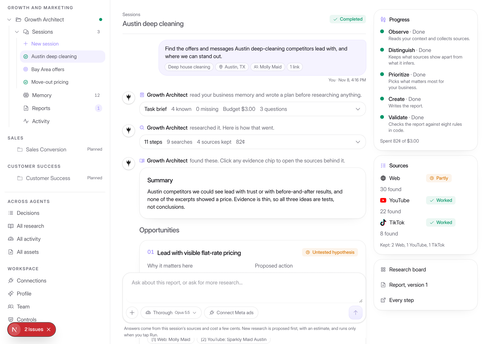

# Visuals and motion

These are the owner's choices, made after a search of 21st.dev for empty states, banners, badges and motion. The ideas came from components such as Illos AI Chat Empty State, Dub's Banner, diceui Status, unlumen Tag and Scroll Reveal. They are built in-house on what the app already has (`motion`, `Skeleton`, `NumberTicker`, `AnimatedShinyText`), so nothing new is installed.

The story page is `/dev/visuals?part=tags|banners|empty|motion`.

## Empty pages: a faded preview of what's coming

`EmptyState` takes a `preview` prop: `cards`, `rows`, `facts` or `board`. The empty page shows a faded, shimmering sketch of the content it will hold. The Vistrial mark, a line saying what will appear, and a **Start a session** button sit over the sketch.

The "NOTHING TO SHOW" caption is gone. The preview kinds are used here:

| Page | Preview |
| --- | --- |
| Decisions | rows |
| All research | cards |
| All activity | rows |
| All assets | rows |
| Agent sessions | cards |
| Agent reports | rows |
| Agent memory | facts |
| Agent activity | rows |
| Research board | board |
| Day, Team, Settings | rows |

Permission and error states keep their plain icon, because a preview would suggest content the person can't have.

## Status tags, not ovals

`Badge` now has square corners (6px) instead of pill corners. `StatusBadge` shows an icon in place of the dot:

- a spinning ring while work runs;
- a check when it's done;
- a clock while it waits;
- an hourglass for "coming soon";
- a warning sign when it fails;
- a cross when it's stopped or off.

The icon is read from the label, so existing call sites didn't change. Pass `icon` to override it.

## Banners

`Banner` (`src/components/ui/banner.tsx`) has a soft gradient wash, a faint grid, an icon tile, a title, one line and an optional action. Its tones are brand, warning, critical, good and neutral, and `compact` gives a smaller version for use inside cards. It's used for:

- the session's "Working on it" and "Waiting for your answer" notices;
- the plan's "Assumed" note;
- the run viewer's "Reconnecting" alert;
- the Meta connection notices.

## Motion

Every animation respects the system's reduced-motion setting.

- **Page entrance.** `PageEnter` fades and unblurs each page as you open it. It's applied once in the product shell.
- **Lists.** `Stagger` and `StaggerItem` make cards and rows cascade in. They use layout animation, so new items slide in, removed ones fade out, and the rest move into place. They're used on Decisions, All research, All assets, agent sessions, reports and memory, and the agent overview.
- **Hover depth.** `HoverLift` lifts a card slightly, with a spotlight that follows the pointer. It's on session cards and asset rows.
- **Live indicators.**
  - Spinning rings in "running" tags and in the Working banner.
  - Shimmering "Working…" text on follow-ups.
  - Count-up numbers on the agent overview.

## Round two: the owner's follow-up choices

- **Empty pages: agent scene over the faded preview.** `AgentScene` shows the Vistrial orb breathing, with a scanning sweep. The real source logos (Web, YouTube, Instagram, TikTok, Meta) circle it, and a "Growth Architect is ready" tag sits beneath. It is drawn over each page's faded preview. Under reduced motion it holds still.
- **Page headers: animated shader banners.** `PageHeader` is now a rounded banner. Behind it, `ShaderBackdrop` runs a small WebGL shader: a slow mesh of brand colours (violet, indigo, pink, sky) with a faint grid.
  - It is tuned for both light and dark themes.
  - It pauses when off-screen or when the tab is hidden, and holds still under reduced motion.
  - Without WebGL it falls back to a CSS gradient.
  - The label ("OWNER", "TODAY") is now a square tag instead of an oval.
- **Planned agents: preview scenes.** Each coming-soon agent opens on a page made of:
  - its own scene, in its own colour, with the logos of the integrations it will use circling it;
  - three capability cards, each with a faded preview;
  - a "Will work with" row of real logos;
  - a **Notify me when it's live** button. This is stored per person and per workspace in the `agentWaitlist` table (`convex/agentWaitlist.ts`), and nothing is sent from it.

  The plans live in `src/lib/agents/planned.ts`.
- **Icons: Phosphor duotone, app-wide.** `src/components/icons` re-exports Phosphor icons under the names the app already used, so every screen switched in one step. Icons use the duotone weight by default. Small UI glyphs (chevrons, close, check, spinners) stay regular so they read cleanly at 12–14px. Brand logos still come from `PlatformLogo`.
- **The chat box is always in a session.** It used to be replaced while the agent worked or waited. Now it stays in place:
  - **While the agent works:** a "Working on it" banner with Stop sits above the box, and the box is disabled.
  - **While a question waits:** the box answers it directly.
  - **For people who can't decide:** the box is shown disabled, with a note.

